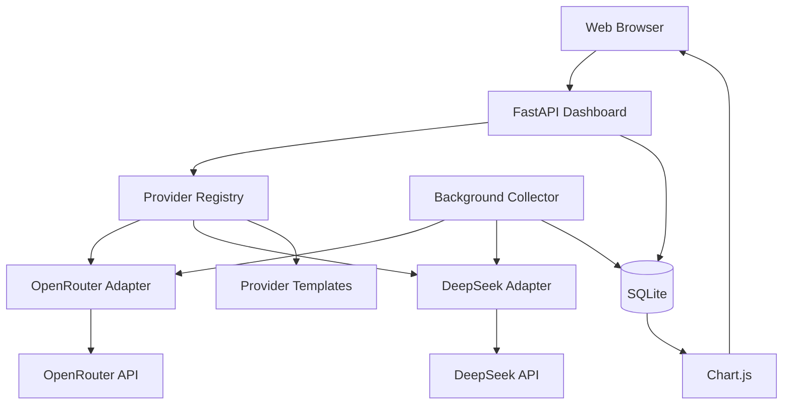

# AI API Cost Dashboard

A self-hosted dashboard for monitoring AI API balances, spending, requests, token usage, historical data, and provider integrations.

Built with:

- FastAPI
- SQLite
- Docker
- Jinja2
- Chart.js

The project does not require a locally running LLM.

> Different AI providers expose different billing and usage APIs. The dashboard only displays metrics that can be retrieved reliably and does not fabricate unsupported values.

---

## Features

- Unified multi-provider overview
- Provider balance monitoring
- Spending analytics
- Request tracking
- Token usage analytics
- Input token tracking
- Output token tracking
- Reasoning token tracking
- Cached token tracking
- Average cost per request
- Average cost per 1K tokens
- Model usage breakdown
- Historical usage charts
- Historical balance charts
- Background snapshot collector
- Provider capability registry
- Responsive dashboard
- Docker deployment
- Demo Mode
- Local SQLite storage

---

## Provider Support

| Provider | Status | Balance | Cost | Tokens | Requests | Models |
|---|---|---:|---:|---:|---:|---:|
| OpenRouter | Implemented | ✅ | ✅ | ✅ | ✅ | ✅ |
| DeepSeek | Implemented | ✅ | Limited | Limited | Limited | — |
| OpenAI | Template | — | Planned | Planned | Planned | Planned |
| Anthropic | Template | — | Planned | Planned | Planned | Planned |
| Google Gemini | Template | Planned | Planned | Planned | Planned | Planned |
| xAI | Template | Planned | Planned | Planned | Planned | Planned |
| Mistral AI | Template | Planned | Planned | Planned | Planned | Planned |
| Generic OpenAI-Compatible | Template | Provider dependent | Provider dependent | Provider dependent | Provider dependent | Provider dependent |

`Limited` means the provider does not currently expose the same account-wide telemetry available from a fully supported integration.

---

# Quick Start

## 1. Clone Repository

Clone the project from GitHub:

```bash
git clone https://github.com/acengkemoceng/api-cost-dashboard.git
```

Enter the project directory:

```bash
cd api-cost-dashboard
```

---

## 2. Create Local Environment File

Copy the provided environment template:

```bash
cp .env.example .env
```

The `.env` file stores local configuration and API credentials.

Never commit `.env` to Git.

---

## 3. Choose Demo Mode or Live Mode

### Demo Mode

Demo Mode lets you explore the dashboard without configuring API credentials.

Edit:

```bash
nano .env
```

Set:

```env
DEMO_MODE=true
```

Save with:

```text
Ctrl+O
Enter
Ctrl+X
```

Demo Mode provides sample:

- balances
- spending
- requests
- token usage
- reasoning tokens
- cached tokens
- model analytics
- OpenRouter history
- DeepSeek balance history

The dashboard displays a `Demo Data` indicator.

Live provider collectors are disabled while Demo Mode is active.

### Live Mode

To use real provider data:

```env
DEMO_MODE=false
```

Then configure credentials for the providers you want to use.

For OpenRouter:

```env
OPENROUTER_API_KEY=
OPENROUTER_MANAGEMENT_KEY=
```

For DeepSeek:

```env
DEEPSEEK_API_KEY=
```

Only add real credentials to `.env`.

---

## 4. Build and Start

Run:

```bash
docker compose up -d --build
```

Check the container:

```bash
docker compose ps
```

The dashboard container should show an `Up` status.

---

## 5. Check Application Health

Run:

```bash
curl http://127.0.0.1:8000/health
echo
```

Example response in Demo Mode:

```json
{
  "status": "ok",
  "service": "ai-api-cost-dashboard",
  "version": "1.2.0",
  "demo_mode": true
}
```

In Live Mode:

```json
"demo_mode": false
```

---

## 6. Open Dashboard

Open:

```text
http://127.0.0.1:8000
```

Main views:

```text
Overview
OpenRouter
DeepSeek
Integrations
```

### Overview

Shows the unified provider summary and tracked telemetry.

### OpenRouter

Shows supported OpenRouter billing and analytics data.

### DeepSeek

Shows balance information and balance history.

### Integrations

Shows implemented and planned provider integrations.

---

## 7. View Logs

Show the latest logs:

```bash
docker compose logs --tail=50
```

Follow logs:

```bash
docker compose logs -f
```

Exit live logs with:

```text
Ctrl+C
```

---

## 8. Stop the Dashboard

```bash
docker compose down
```

The SQLite database remains in:

```text
data/
```

so historical data survives normal container recreation.

---

## 9. Start Again

If there were no source code changes:

```bash
docker compose up -d
```

If source code or dependencies changed:

```bash
docker compose up -d --build
```

---

# Demo Mode to Live Mode

Edit:

```bash
nano .env
```

Change:

```env
DEMO_MODE=true
```

to:

```env
DEMO_MODE=false
```

Add the required API credentials and recreate the container:

```bash
docker compose up -d --force-recreate
```

---

# OpenRouter Integration

Configure:

```env
OPENROUTER_API_KEY=
OPENROUTER_MANAGEMENT_KEY=
```

Current OpenRouter support includes:

- remaining credits
- account usage
- daily usage
- weekly usage
- monthly usage
- spending analytics
- request count
- total token usage
- input tokens
- output tokens
- reasoning tokens
- cached tokens
- average cost per request
- average cost per 1K tokens
- model breakdown
- local usage snapshots

The Management Key is used for account-level analytics and credit information.

---

# DeepSeek Integration

Configure:

```env
DEEPSEEK_API_KEY=
```

Current support includes:

- available balance
- topped-up balance
- granted balance
- API availability
- balance history

The dashboard intentionally does not infer account-wide request or token usage from balance changes.

---

# Data Storage

Historical data is stored locally in:

```text
data/dashboard.db
```

Docker Compose mounts the `data` directory into the application container.

Database files are excluded from Git.

---

# API Endpoints

## Health

```text
GET /health
```

## Provider Registry

```text
GET /api/providers
```

## OpenRouter

```text
GET /api/providers/openrouter
GET /api/providers/openrouter/credits
GET /api/providers/openrouter/analytics
GET /api/history/openrouter
```

## DeepSeek

```text
GET /api/providers/deepseek
GET /api/history/deepseek
```

## Collector

```text
GET /api/collector/status
```

---

# Architecture



---

# Project Structure

```text
api-cost-dashboard/
├── app/
│   ├── __init__.py
│   ├── database.py
│   ├── demo.py
│   ├── main.py
│   ├── registry.py
│   │
│   ├── providers/
│   │   ├── __init__.py
│   │   ├── base.py
│   │   ├── deepseek.py
│   │   └── openrouter.py
│   │
│   ├── static/
│   │   ├── dashboard.js
│   │   └── style.css
│   │
│   └── templates/
│       └── dashboard.html
│
├── data/
│   └── .gitkeep
│
├── .dockerignore
├── .env.example
├── .gitignore
├── CHANGELOG.md
├── CONTRIBUTING.md
├── Dockerfile
├── LICENSE
├── README.md
├── SECURITY.md
├── compose.yaml
└── requirements.txt
```

---

# Security

The Docker configuration binds the application to:

```text
127.0.0.1:8000
```

by default.

API credentials remain server-side.

Never commit:

- `.env`
- API keys
- management keys
- access tokens
- runtime databases

Do not expose the dashboard directly to the public internet without authentication and appropriate network security.

See `SECURITY.md`.

---

# Roadmap

Planned integrations and improvements include:

- OpenAI organization usage integration
- Anthropic organization usage integration
- xAI billing and usage integration
- Mistral usage integration
- Google Gemini / Google Cloud billing integration
- Generic OpenAI-compatible providers
- configurable date ranges
- usage alerts
- CSV export
- authentication
- automated testing
- additional historical analytics

---

# Contributing

Contributions are welcome.

See:

```text
CONTRIBUTING.md
```

---

# License

Released under the MIT License.

See:

```text
LICENSE
```
